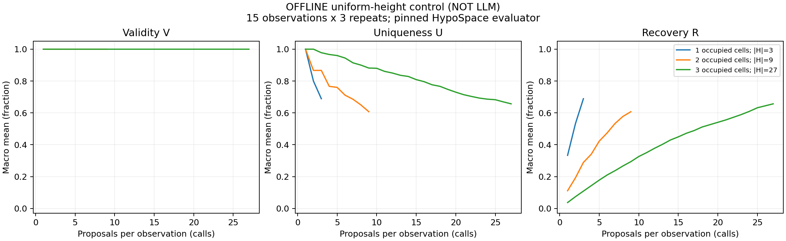

# HypoSpace Final Project — EEC 4300

3D reconstruction experiment infrastructure for a four-person course project.

**Status:** official data generation, evaluation, recording and plotting have run successfully on a 585-proposal **offline uniform-height control**. A real LLM baseline has **not** run: model selection and API spending authorization remain pending. Offline control scores must not be presented as LLM results.

## Start here

- [Shared protocol and exact commands](docs/baseline-protocol.md)
- [Configuration](experiments/protocol.json) and [fixed split manifest](experiments/manifest.json)
- [Experiment log](docs/experiment-log.md)
- [Copyable Chinese teammate prompt](docs/team-message.txt)
- [Contribution workflow](CONTRIBUTING.md)

The official benchmark is fetched at a pinned revision into ignored `.cache/`; datasets and raw outputs stay local. Our runner uses the original official prompt/parser/evaluator and adds recording, resumption, method hooks and prefix curves. No secrets are needed for offline verification.

```sh
python -m pip install -r requirements.txt
python experiments/bootstrap.py
python src/hypospace_runner.py --prepare
python -m unittest discover -s tests -v
python src/hypospace_runner.py --mode offline --out runs/offline
python src/plot_results.py runs/offline/summary.json --out docs/figures/offline
```



## Project requirement

Develop a novel ML method improving LLM performance on HypoSpace. Deliver a public GitHub repository and a 10-minute group video with all four members presenting. Shared parameters: grid 3x3, height 3, 1/2/3 occupied cells, 15 test observations x 3 repeats, Q=|H|. Model still needs to be locked before final comparison.

## References

- [Chen et al. (2026), HypoSpace, PMLR 306](https://proceedings.mlr.press/v306/chen26bz.html)
- [Official implementation](https://github.com/CTT-Pavilion/_HypoSpace), revision `c69e9318577b34b5b896996571aefd4ba6053f58`.

Independent student project, not the official benchmark repository.
