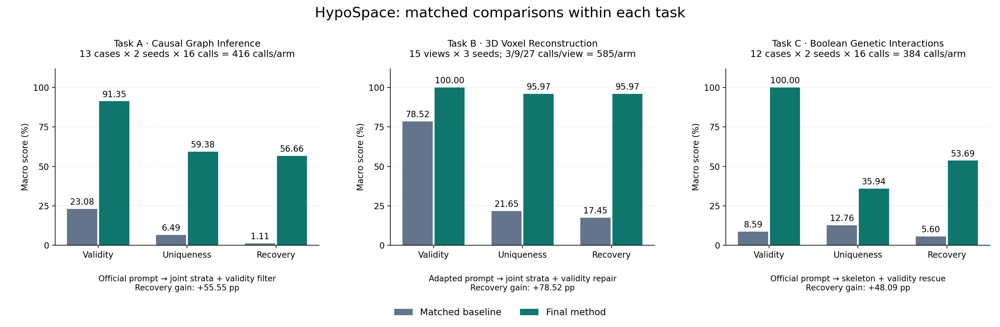

# HypoSpace — Exploring Sets of Scientific Hypotheses

HypoSpace asks whether a model can discover **many distinct, valid explanations** when observations admit more than one answer. Our EEC 4300 project builds local small-model baselines and evaluates coverage-guided generation, spatial representations, and hierarchical generation across all three domains. Read the [original paper](https://proceedings.mlr.press/v306/chen26bz.html), then explore [Task A: causal graphs](methods/task-a/README.md), [Task B: 3D reconstruction](methods/task-b/README.md), or [Task C: Boolean interactions](methods/task-c/README.md).

## Results at a Glance

**Within-task comparisons, not a ranking across domains.** All numbers below are our group's local Qwen2.5-3B-Instruct experiments—not the paper's published model scores. “Official prompt” means our local execution of the upstream prompt.

| Task / headline setting | Main method | Matched baseline R | Method R | Δ Recovery | Details |
| --- | --- | ---: | ---: | ---: | --- |
| A · 13 cases, seeds 17/42, 16 calls per case-seed | Two-level stratification + validity filter | Official prompt: 1.11% | **56.66%** | **+55.55 pp** | [Causal report](methods/task-a/kevin-causal-graph/experiment-results.md) |
| B · 15 views, seeds 17/42/2026, 3/9/27 calls per view-seed | Two-level stratification + validity repair | Adapted baseline: 17.45% | **95.97%** | **+78.52 pp** | [3D report](methods/task-b/kevin-twolevel-stratification/docs/experiment-results-3d.md) |
| C · 12 cases, seeds 17/42, 16 calls per case-seed | One-hole skeleton + validity rescue | Official prompt: 5.60% | **53.69%** | **+48.09 pp** | [Boolean report](methods/task-c/kevin-boolean/experiment-results.md) |



[Vector version](docs/figures/results-overview.svg). Each panel uses its own matched baseline and test protocol. A/C comparisons are transcribed from their formal reports; B is also checked against committed per-instance JSON. Gains are percentage points, not relative percentages. A/C gains use the displayed two-decimal means; the reports round their paired deltas to one decimal (+55.6 / +48.1 pp). Final methods include deterministic assembly/filtering/repair, so these are **end-to-end procedure scores**, not unprocessed LLM-output scores.

## Task A — Causal Graph Inference

**Task:** infer labeled DAGs consistent with observed intervention effects, including both positive and zero effects. **Method:** Kevin's final hierarchy fixes feasible parent sets for two nodes, preserves mandatory edges, and greedily filters model-added edges to maintain graph constraints.

### Main matched study

Four nodes, at most four edges; **13 test cases × 2 seeds (17/42) × 16 calls = 416 calls per method**. V and U below are at 16 calls; Recovery prefixes reuse the same generated sequence.

| Method / control | Validity | Uniqueness | R@4 | R@8 | R@16 |
| --- | ---: | ---: | ---: | ---: | ---: |
| Official prompt | 23.08% | 6.49% | 1.11% | 1.11% | 1.11% |
| Unstratified, same wording | 61.30% | 10.34% | 14.26% | 14.74% | 14.74% |
| Edge-count strata | 39.90% | 16.11% | 12.21% | 12.21% | 12.66% |
| Parent-set strata | 50.24% | 27.40% | 15.44% | 16.27% | 19.07% |
| Skeleton completion | 50.00% | 32.45% | 16.69% | 18.83% | 19.78% |
| Forced backbone | 68.99% | 32.93% | 28.63% | 30.87% | 31.53% |
| Validity filter only (ablation) | 85.10% | 29.81% | 29.44% | 31.60% | 32.36% |
| **Two-level joint + validity filter** | **91.35%** | **59.38%** | **36.34%** | **47.34%** | **56.66%** |

The final procedure improves Recovery by **55.55 pp** over the official prompt and **41.92 pp** over the same-wording unstratified control, on the report-matched @16 protocol.

<details>
<summary>Other reported settings, development studies, and the independent SZH baseline</summary>

**Same 13 cases, three seeds (17/42/2026), 13-call prefixes:** 507 prefix calls per method.

| Method | Validity | Uniqueness | R@13 |
| --- | ---: | ---: | ---: |
| Forced backbone | 71.79% | 41.03% | 32.08% |
| Validity filter | 86.00% | 36.29% | 33.07% |
| Two-level joint + validity filter | 91.12% | 65.09% | 53.43% |

**Independent SZH adapted baseline:** same model family, but 512-token CPU inference rather than the hierarchy study's 256-token GPU setting. No Δ against the hierarchy is claimed for these rows.

| Setting | Validity | Uniqueness | Recovery | Calls represented |
| --- | ---: | ---: | ---: | ---: |
| Unified subset: 10 cases, 3 seeds, budget = compatible graphs | 5.05% | 24.66% | 0.37% | 654 |
| Aligned 13 cases, seeds 17/42, prefix 16 | 26.92% | 12.74% | 3.75% | 416 |
| Aligned 13 cases, 3 seeds, prefix 13 | 27.81% | 16.17% | 3.89% | 507 |

The SZH rows are subsets/prefixes of one **2,019-call** causal batch; do not sum them as separate runs. The unified subset differs from the hierarchy study's test cohort.

**Development progression:** parent-set strata R@16 13.36%; skeleton completion 18.34%; forced backbone 21.91%; final joint method V/U/R 71.88% / 65.62% / 59.30%. V/U for the first three development entries are N/A in the archived causal report. These are not test results.

**Earlier eight-case study (separate protocol, contextual only):** reported R is 0.13% for official prompting, 21.51% for fixed structural rotation, 21.52% for adaptive scheduling, 46.84% for a legal-edit menu, and 59.49% for random choice with backtracking. V/U and full protocol artifacts are N/A in the archived summary; these rows are excluded from the headline comparison.

</details>

**Sources and evidence:** [formal hierarchy report and per-case tables](methods/task-a/kevin-causal-graph/experiment-results.md); [available model/sampling definitions](src/causal_benchmark.py); [SZH protocol](methods/common/szh-baseline-common/protocol.json), [SZH scores](methods/task-a/szh-baseline-causal/reports/test.json), [SZH raw archive](methods/task-a/szh-baseline-causal/reports/raw.jsonl.gz), and [SZH audit](methods/task-a/szh-baseline-causal/reports/audit.json). The hierarchy report names its final protocol and audit scripts on the originating branch, but the **final 13-case protocol JSON, final hierarchy launcher, and machine-readable final results are not archived on main**; its scores and reported audits are not independently replayed here. Cases were reused across hierarchy generations; the report discloses a post-test acyclicity repair and regeneration of 138 affected records.

## Task B — 3D Voxel Reconstruction

**Task:** reconstruct gravity-supported cube stacks from a top-view footprint on a 3 × 3 grid, with maximum height three. **Methods:** JCJ appends coverage feedback; ZJH uses occupied-column representations and a cyclic height codec; Kevin's final method stratifies layer sizes, enforces anchors, and repairs/falls back to a legal in-stratum structure.

### Formal test results

All rows below use the frozen **15 top views × 3 seeds (17/42/2026)** with **3, 9, or 27 proposals per view-seed**, according to occupied-cell count: **585 proposals per method**. The offline control uses 585 symbolic samples, not LLM calls.

| Method / control | Validity | Uniqueness | Recovery | ΔR vs Adapted |
| --- | ---: | ---: | ---: | ---: |
| SZH Original: official prompt | 0.00% | 55.56% | 0.00% | −17.45 pp |
| SZH Adapted baseline | 78.52% | 21.65% | 17.45% | — |
| JCJ coverage-guided | 77.86% | 25.27% | 21.89% | +4.44 pp |
| ZJH column planning, model-rendered layers | 44.69% | 32.84% | 17.70% | +0.25 pp |
| ZJH cyclic height codec | 100.00% | 61.73% | 61.73% | +44.28 pp |
| Kevin official-prompt rerun | 0.00% | 57.12% | 0.00% | −17.45 pp |
| Kevin uniform random control (offline) | 100.00% | 65.10% | 65.10% | N/A: non-LLM control |
| **Kevin two-level strata + validity repair** | **100.00%** | **95.97%** | **95.97%** | **+78.52 pp** |

The headline final method improves Recovery by **78.52 pp** over the matched Adapted baseline; ZJH's final codec gains **44.28 pp**, while JCJ's **4.44 pp** gain falls below its preregistered +5 pp target.

<details>
<summary>Reported prefix controls and development-only ablations</summary>

The Kevin report uses R@k capped at each case's available budget (cases have 3/9/27 proposals); R@27 is the aggregate final-budget score, not 27 calls on every case.

| Method | R@1 | R@3 | R@9 | R@27 |
| --- | ---: | ---: | ---: | ---: |
| SZH Adapted | 14.32% | 16.30% | 17.37% | 17.45% |
| Kevin official-prompt rerun | 0.00% | 0.00% | 0.00% | 0.00% |
| Uniform random control | 16.05% | 36.21% | 53.00% | 65.10% |
| Kevin final | 16.05% | 48.15% | 77.12% | 95.97% |

**Kevin development ablations (3 views, seed 17, dev-smoke; not formal test):**

| Generation | Validity | Uniqueness | Recovery |
| --- | ---: | ---: | ---: |
| Verbal layer-size strata | 83.95% | 28.40% | 17.28% |
| Forced ground layer + repair | 100.00% | 30.86% | 30.86% |
| Single-level strata + repair | 100.00% | 38.27% | 38.27% |
| Joint strata + repair | 100.00% | 97.53% | 97.53% |

The final method's full-development V/U/R are 100.00% / 95.27% / 95.27%.

**ZJH matched full-development ablation (6 views, three seeds, 234 calls per arm):**

| Method | Validity | Uniqueness | Recovery |
| --- | ---: | ---: | ---: |
| Adapted | 100.00% | 19.96% | 19.96% |
| Fixed row-major height codec | 100.00% | 55.56% | 55.56% |
| Cyclic height codec | 100.00% | 64.20% | 64.20% |

**ZJH first development screen (6 views, seed 17, three calls each; 18 calls per arm):**

| Method | Validity | Uniqueness | Recovery |
| --- | ---: | ---: | ---: |
| Adapted | 100.00% | 38.89% | 17.90% |
| Column planning, grid history | 72.22% | 55.56% | 24.69% |
| Column planning, compact history | 66.67% | 55.56% | 20.99% |

JCJ's statistics-only and cell-only hooks exist, but their development ablations were not run; scores are **N/A**, not zero. Finer difficulty/seed tables and paired intervals remain in the linked reports.

</details>

**Sources:** [SZH paired report](methods/task-b/szh-baseline-3d/docs/paired-results.md), [Original metrics](methods/task-b/szh-baseline-3d/original/reports/metrics.json), [Adapted metrics](methods/task-b/szh-baseline-3d/adapted/reports/metrics.json); [JCJ report](methods/task-b/jcj-coverage-guided/docs/cg-report.md) and [metrics](methods/task-b/jcj-coverage-guided/reports/metrics.json); [ZJH report](methods/task-b/zjh-spatial/README.md), [layer results](methods/task-b/zjh-spatial/reports/layer-test/metrics.json), [codec results](methods/task-b/zjh-spatial/reports/codec-test/metrics.json); [Kevin report](methods/task-b/kevin-twolevel-stratification/docs/experiment-results-3d.md), [per-instance summary](methods/task-b/kevin-twolevel-stratification/reports/joint-test-summary.json), [comparison JSON](methods/task-b/kevin-twolevel-stratification/reports/metrics.json), and [protocol](methods/task-b/kevin-twolevel-stratification/experiments/protocol-3d.json). Shared [configuration](methods/task-b/szh-baseline-3d/experiments/protocol.json), [split](methods/task-b/szh-baseline-3d/experiments/manifest.json), and [model lock](methods/task-b/szh-baseline-3d/experiments/model-lock.json) document the matched 3D conditions.

The two official-prompt rows are separate local runs: their U differs (55.56% vs 57.12%), while both V/R are measured zeros. Kevin's committed summary confirms five views at each difficulty; its report's “b1 (3 cases)” caption is inconsistent with that configuration. The ZJH codec includes schema-constrained output and inverse decoding; Kevin includes deterministic repair/fallback. Timings across different CPU machines are not efficiency rankings. SZH raw archives are committed; other methods' raw responses are generally local-only, with submitted manifests/audit reports retained.

## Task C — Boolean Genetic Interactions

**Task:** infer Boolean expressions consistent with partial observations of two variables, using the official mechanistic notion of structural distinctness. **Method:** Kevin fixes a one-hole skeleton within truth-table-completion strata and deterministically rescues invalid leaf choices; 100% Validity includes this assembly/rescue, rather than raw model output alone.

### Main matched study

Full operators (AND/OR/NOT/NOR), maximum depth two; **12 test cases** (six with two observations, six with three), **seeds 17/42**, and **16 calls per case-seed = 384 calls per method**. V/U are at 16 calls; prefixes reuse the same records.

| Method / control | Validity | Uniqueness | R@4 | R@8 | R@13 | R@16 |
| --- | ---: | ---: | ---: | ---: | ---: | ---: |
| Official prompt | 8.59% | 12.76% | 4.41% | 5.60% | 5.60% | 5.60% |
| Completion strata | 5.21% | 5.21% | 0.70% | 1.34% | 1.66% | 1.66% |
| One-hole skeleton | 32.03% | 18.23% | 12.04% | 21.34% | 26.85% | 28.89% |
| **Skeleton + validity rescue** | **100.00%** | **35.94%** | **32.89%** | **44.63%** | **51.99%** | **53.69%** |

The final procedure improves Recovery by **48.09 pp** over its report-matched official-prompt baseline at 16 calls, with the deterministic rescue contribution included.

<details>
<summary>Independent SZH baseline and development-only pilot</summary>

The SZH adapted baseline reports **V=14.35%, U=8.76%, R=2.98%**, using five shared test observations in each of the basic/extended/full operator regimes, three seeds (17/42/2026), and budget = compatible expressions (**270 calls**). It uses a different observation collection, operator-regime mix, 512-token CPU configuration, and per-case budgets; **Δ against Kevin's final method is N/A**.

**Kevin development pilot (4 cases, seed 17, 16 calls; 64 calls per method):**

| Method | Validity | Uniqueness | R@16 |
| --- | ---: | ---: | ---: |
| Official prompt | 1.56% | 9.38% | 2.27% |
| Completion strata | 0.00% | 6.25% | 0.00% |
| Skeleton | 20.31% | 17.19% | 24.32% |
| Skeleton + validity rescue | 100.00% | 37.50% | 51.36% |

</details>

**Sources:** [formal comparison](methods/task-c/kevin-boolean/experiment-results.md), [detailed method/disclosures](docs/boolean-experiment-results.md), [12-case protocol](experiments/boolean-skeleton.json), [runner](experiments/run_boolean_skeleton.py), [analysis script](experiments/analyze_boolean.py), [available model settings](src/causal_benchmark.py); [SZH protocol](methods/common/szh-baseline-common/protocol.json), [scores](methods/task-c/szh-baseline-genetic/reports/test.json), [raw archive](methods/task-c/szh-baseline-genetic/reports/raw.jsonl.gz), and [audit](methods/task-c/szh-baseline-genetic/reports/audit.json).

Kevin's report cites `.cache/boolean-test.json` and local `runs/` as its numeric/raw sources; these files are **not committed on main**, so its table and reported audits are report-level evidence here. The official Boolean generator/validator also disagrees on some reference expressions; scores retain the official denominator. The reported ≈57.6% ceiling has not been independently rederived here, and 53.69% is below that ceiling—we do not attribute the entire remaining gap to unreachable reference keys.

## Evaluation and Reproduction

We **follow HypoSpace's task definitions, legality constraints, and evaluation framework**, pinned to upstream `c69e9318577b34b5b896996571aefd4ba6053f58`. All showcased local studies use **Qwen2.5-3B-Instruct Q4_K_M with Ollama 0.40.18**, temperature 0.7, top-p 0.9, top-k 40, repeat penalty 1.0 and context 8,192. Prompt adaptation, history, output representation, assembly, and budgets are task/method-specific.

| Study | Output limit | Device request | Test units and budget |
| --- | ---: | --- | --- |
| SZH A/C adapted baselines | 512 tokens | CPU (`num_gpu=0`, 4 threads) | A: 10 cases × 3 seeds, compatible-graph budget; C: 15 operator-case settings × 3 seeds, compatible-expression budget |
| Kevin A/C matched studies | 256 tokens | GPU requested (`num_gpu=99`, 4 CPU threads) | A: 13 × 2 × 16; C: 12 × 2 × 16 |
| Task B matched studies | 512 tokens | CPU (`num_gpu=0`, 4 threads) | 15 views × 3 seeds; 3/9/27 calls by occupied-cell count |

**V** measures valid attempts; **U** measures distinct parsed/in-space proposals under each official task evaluator; **R** measures recovered reference hypotheses using task-specific canonicalization. All attempts, including failures and duplicates, consume budget. Tables report macro means; micro pooling, sample/seed logs, source freezes and bootstrap intervals remain in detailed artifacts. Model-assembly methods score assembled/repaired outputs. The test sets in several iterative studies are not strictly unseen; consult each report's disclosure. Neither cross-domain deltas nor raw-output-versus-repaired-output equivalence is claimed.

Use the [shared setup and current entry points](methods/common/szh-baseline-common/README.md) and [3D setup](methods/task-b/szh-baseline-3d/docs/local-setup.md). Commands below are existing, checked interfaces; install dependencies and prepare the pinned official dataset first. No commercial API is required.

```powershell
# Replay the two committed 585-call 3D archives; no inference.
python experiments/audit_integration.py

# Restore committed SZH A/C archives, then audit; no inference.
python experiments/restore_all_domains_archive.py --domain causal
python experiments/audit_all_domains.py --domain causal
python experiments/restore_all_domains_archive.py --domain genetic
python experiments/audit_all_domains.py --domain genetic

# Inspect the final Boolean runner (replay requires the author's local raw runs).
python experiments/run_boolean_skeleton.py --help

# Inspect the final 3D hierarchical runner.
python methods/task-b/kevin-twolevel-stratification/src/hypospace_runner_3d.py --help
```

The final causal hierarchy's complete replay entry/configuration is N/A on main; do not substitute the older eight-case `run_causal.py` as if it reproduced the 13-case final study. See [task-organized methods](methods/) for code, configurations, reports, figures, and the explicitly documented limits of available historical raw records.
