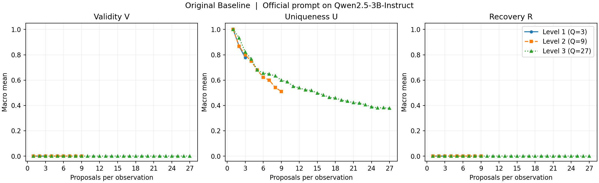
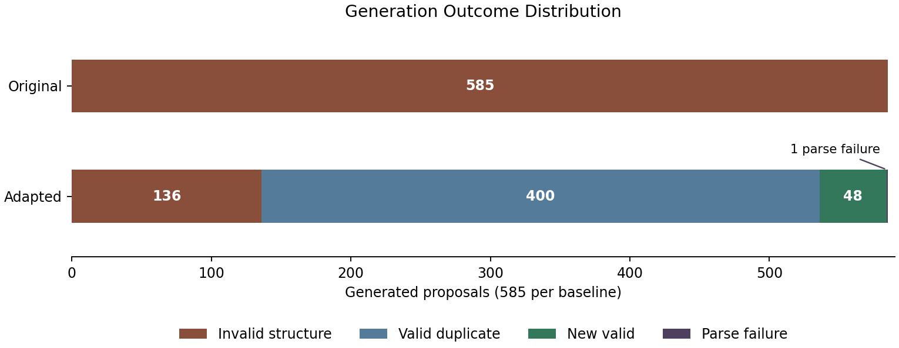

# HypoSpace: Generating 3D Hypotheses with Qwen2.5-3B

A top view tells us which cells contain cubes, but leaves their heights unknown. This project studies how many different, physically valid stacks a local language model can recover from that single view. We evaluate two prompts on the 3D reconstruction task from [HypoSpace](https://proceedings.mlr.press/v306/chen26bz.html).

Both baselines completed **585 generations** on the same 15 test observations. The official prompt recovered no valid stacks. Making the projection and support rules explicit raised mean Recovery to **17.45%**, but the model still repeated many of its valid answers. The **Adapted Baseline** is the frozen reference for all three follow-up methods.

## Research Motivation

Finding one valid stack and exploring the full set of compatible stacks are different problems. At Level 3 the adapted prompt achieved **80.00% Validity** but recovered only **4.20%** of the compatible structures on average. Our next experiments target higher **Recovery and Uniqueness** while maintaining or improving **Validity**, with the same model, evaluator, test observations and 585-call budget. Planning and repair calls count toward that budget.

## Overall Baseline Results

| Metric | Original | Adapted | Change (percentage points) |
| --- | ---: | ---: | ---: |
| Validity (V) | 0.00% | 78.52% | +78.52 |
| Uniqueness (U) | 55.56% | 21.65% | −33.91 |
| Recovery (R) | 0.00% | 17.45% | +17.45 |

**Validity** is the fraction of all proposals accepted by the official validator. **Uniqueness** is the number of distinct parsed structures divided by all proposals, including failed attempts in the denominator. **Recovery** is the fraction of enumerated ground-truth structures found at least once. Each score is computed separately for one observation and seed. Overall scores give all 45 observation–seed pairs equal weight. Changes use the unrounded means. [Paired results](methods/task-b/szh-baseline-3d/docs/paired-results.md) · [Scoring audit](methods/task-b/szh-baseline-3d/docs/baseline-audit.md)

## Results by Difficulty

Level counts occupied cells in the observed 3 × 3 grid. Each occupied cell can have height 1, 2 or 3, giving 3, 9 or 27 compatible structures. Each level contains five test observations evaluated with three seeds. Calls are per baseline.

| Level | Calls per observation and seed | Total calls | Original V | Original U | Original R | Adapted V | Adapted U | Adapted R |
| --- | ---: | ---: | ---: | ---: | ---: | ---: | ---: | ---: |
| 1 | 3 | 45 | 0.00% | 77.78% | 0.00% | 95.56% | 42.22% | 37.78% |
| 2 | 9 | 135 | 0.00% | 51.11% | 0.00% | 60.00% | 17.04% | 10.37% |
| 3 | 27 | 405 | 0.00% | 37.78% | 0.00% | 80.00% | 5.68% | 4.20% |


### Coverage over successive proposals

Recovery@k measures the fraction of each observation's ground-truth set found in its first *k* proposals. Each line averages the 15 observation–seed pairs at that level. Histories reset between seeds.


**Original Baseline.** The official prompt produced distinct parseable structures at every level, while Validity and Recovery stayed at zero throughout.



**Adapted Baseline.** The gap between Validity and Recovery shows how often valid proposals revisit previously found structures.


## Computational Cost

| Baseline | Model calls | Input tokens | Output tokens | Summed request time (s) | Truncated outputs | Commercial API fees |
| --- | ---: | ---: | ---: | ---: | ---: | ---: |
| Original | 585 | 561,221 | 64,641 | 11,028.3 | 8 | $0 |
| Adapted | 585 | 178,307 | 28,776 | 3,275.1 | 0 | $0 |

Time is the sum of recorded local model-request durations on the baseline CPU machine. Truncated outputs remain in the evaluation. Commercial fees exclude hardware and electricity. [Original measurements](methods/task-b/szh-baseline-3d/original/reports/metrics.json) · [Adapted measurements](methods/task-b/szh-baseline-3d/adapted/reports/metrics.json)

## Failure Analysis

**Original.** All 585 responses parsed, but every structure projected to a different top view from the input. In 313 cases the projection matched the four-corner pattern in the official prompt's example. That pattern occupies four cells, whereas the test inputs occupy one to three. The pattern is consistent with copying the example, although the paired experiment cannot isolate its causal effect. Original's higher U measures diversity among incorrect structures. None contributed to Recovery.

**Adapted.** Of 585 proposals, 448 passed validation, 136 had an incorrect projection and one failed to parse. Among the valid proposals, **400 repeated a structure already seen within the same observation and seed**. The remaining 48 were first discoveries within their respective runs. These are pooled counts; the percentages above are macro averages. [Failure analysis and counting rules](methods/task-b/szh-baseline-3d/docs/formal-failures.md)

### Generation Outcome Distribution



## Experimental Protocol

- **Original** uses the pinned upstream user prompt and its history of previously generated structures. **Adapted** spells out row and column order, explains why the bottom layer must equal the top view, and requires each upper layer to be supported by the layer below. It replaces the worked four-corner example with a layer-format template and changes how the generated history is displayed. The generator sees the observation and its own earlier outputs. Only the evaluator uses the enumerated ground truths.
- **Model and decoding.** Qwen2.5-3B-Instruct, Q4_K_M, served by Ollama 0.40.18 on localhost. Temperature 0.7, top-p 0.9, top-k 40, output limit 512 tokens, context length 8,192 and repeat penalty 1.0. Both methods use repeat seeds 17, 42 and 2026.
- **Data and budget.** The pinned generator enumerates 129 top views. A fixed stratified split selects two development and five test observations per level. Each observation–seed pair receives as many calls as it has compatible structures. Both methods use one attempt per proposal and share the parser, normalization, validator and hash-based scoring.

[Protocol](methods/task-b/szh-baseline-3d/docs/baseline-protocol.md) · [Prompt and evaluator audit](methods/task-b/szh-baseline-3d/docs/baseline-audit.md) · [Frozen configuration](methods/task-b/szh-baseline-3d/experiments/protocol.json) · [Split manifest](methods/task-b/szh-baseline-3d/experiments/manifest.json) · [Model lock](methods/task-b/szh-baseline-3d/experiments/model-lock.json)

## Reproducibility and Data

The published measurements can be inspected without running inference. Each compressed archive contains the recorded requests, responses, token counts and timings. SHA-256 manifests identify the original records.

| Baseline | Measurements and per-call curves | Raw records | Checksums |
| --- | --- | --- | --- |
| Original | [Metrics](methods/task-b/szh-baseline-3d/original/reports/metrics.json) | [JSONL archive](methods/task-b/szh-baseline-3d/original/reports/raw.jsonl.gz) | [SHA-256 manifest](methods/task-b/szh-baseline-3d/original/reports/raw-manifest.json) |
| Adapted | [Metrics](methods/task-b/szh-baseline-3d/adapted/reports/metrics.json) | [JSONL archive](methods/task-b/szh-baseline-3d/adapted/reports/raw.jsonl.gz) | [SHA-256 manifest](methods/task-b/szh-baseline-3d/adapted/reports/raw-manifest.json) |

For an independent reproduction, install Git, Python 3.12 and the pinned Ollama version. Keep the Python environment and model on a local SSD. Run the following from the repository root using the activated environment and a running local Ollama service. The PowerShell example stores new runs under the user profile. [Local setup and model verification](methods/task-b/szh-baseline-3d/docs/local-setup.md)

```powershell
python -m pip install -r requirements.txt
ollama pull qwen2.5:3b-instruct-q4_K_M
python methods/task-b/szh-baseline-3d/experiments/bootstrap.py
python methods/task-b/szh-baseline-3d/src/hypospace_runner.py --prepare
$runs = Join-Path $env:USERPROFILE 'HypoSpaceLocal/runs'
python methods/task-b/szh-baseline-3d/src/hypospace_runner.py --out "$runs/original-formal-v4"
python methods/task-b/szh-baseline-3d/src/hypospace_runner.py --method adapted_baseline:transform --out "$runs/adapted-formal-v4"
```

To regenerate the paired score and coverage figures from the published metrics alone, run `python methods/task-b/szh-baseline-3d/experiments/paired_baselines.py`. After preparing the dataset, run `python methods/task-b/szh-baseline-3d/experiments/diagnose_archives.py` to reproduce the failure counts from the archives.

## Limitations

The study covers one quantized model, one reconstruction task and 15 test observations. The three seed repeats share those observations. History-conditioned proposals also depend on earlier outputs. A history-handling defect was diagnosed using partial test outputs from an aborted run. The fix was checked again on development data before the complete 585-call Adapted run. Sampling parameters were frozen, but the test set had been partially inspected during the repair. [Development analysis](methods/task-b/szh-baseline-3d/docs/dev-analysis.md) · [Freeze record](methods/task-b/szh-baseline-3d/docs/baseline-freeze.json)

## Team Contributions

| Team member | Project responsibility |
| --- | --- |
| Zhiheng Song | Original and Adapted Baselines |
| Wentao Lin | Hierarchical Generation |
| Chenjun Jiang | Adaptive Coverage-guided Generation |
| Jianghan Zhao | Spatial Representation Transformation |

[Team handoff and submission instructions](docs/team-message.txt)

## Baseline Results Across Three Domains

| Domain | Model | Validity | Uniqueness | Recovery | LLM Calls |
| --- | --- | ---: | ---: | ---: | ---: |
| Causal Graph Inference | Qwen2.5-3B | 5.05% | 24.66% | 0.37% | 654 |
| 3D Voxel Reconstruction | Qwen2.5-3B | 78.52% | 21.65% | 17.45% | 585 |
| Boolean Genetic Interaction | Qwen2.5-3B | 14.35% | 8.76% | 2.98% | 270 |

These are within-domain diagnostic measurements, not a fair comparison of algorithm performance across domains. The unified baseline uses the frozen 3D sampling parameters, task-adapted prompts and official scoring. New runs use seeds 17/42/2026 and one call per compatible hypothesis on their frozen test subsets. The causal study uses four nodes and at most four edges; Boolean studies basic/extended/full operators at depth two. The 3D figures are preserved from the archived report; its published 585-call compressed raw archive has been independently replayed on this machine (see historical-3d-replay.json).

The causal alignment protocol reuses a single batch on LWT's 13 final test cases at budgets 4/8/13/16. Total new causal calls including alignment are 2019. Macro means weight instances equally; micro pooling and across-seed sample standard deviations are reported separately. Different official budgets and solution-space sizes make cross-domain Recovery incomparable as an algorithm ranking.

See [all-domain report](docs/baseline-all-domains/results.md), [shared reproduction commands](methods/common/szh-baseline-common/README.md), and task-specific tracked reports and raw SHA256 manifests.

Causal table metrics and 654 calls describe the unified subset; 1,365 additional calls support the separate alignment cohort (2,019 new causal calls total). New formal inference and full replay are complete. The official Boolean reference/validator inconsistency and historical LWT replay limitation are disclosed in the all-domain audit.

## Method directories (integration)

```text
methods/
├── task-a/
│   └── szh-baseline-causal/
├── task-b/
│   ├── szh-baseline-3d/
│   │   ├── original/
│   │   └── adapted/
│   ├── jcj-coverage-guided/
│   └── zjh-spatial/
├── task-c/
│   └── szh-baseline-genetic/
└── common/
    └── szh-baseline-common/
```

Task A: Causal Graph Inference; Task B: 3D Voxel Reconstruction; Task C: Boolean Genetic Interaction; Common: Shared Utilities.

[3D baselines](methods/task-b/szh-baseline-3d/README.md) · [JCJ method](methods/task-b/jcj-coverage-guided/README.md) · [ZJH method](methods/task-b/zjh-spatial/README.md) · [Task A](methods/task-a/szh-baseline-causal/README.md) · [Task C](methods/task-c/szh-baseline-genetic/README.md)

JCJ submitted formal results (585 calls): valid_rate=77.86%, novelty_rate=25.27%, recovery_rate=21.89%. Its raw responses are not included; the submitted SHA256 inventory and reports are preserved. Historical per-call replay was not independently verified.
## Task C method — Boolean hierarchical route (分支 `kevin/boolean`)

Kevin 的布尔基因互动（Task C）方法沿用因果域已验证的分层生成路线：**补全分层
`completion`（第 1 代）→ 单孔骨架 `skeleton`（第 2 代）→ 单孔骨架 + 有效性救援
`skeleton_valid`（最终方法）**。只用公开观测与空间定义先验分层，不读参考答案、不做覆盖
反馈、不改表示；救援只对模型自己骨架上的槽位叶子做确定性最小修正（模型自填通过率
45.05%）。官方提示基线保持上游完整流程、未做任何修改。

配对协议（12 题 × 种子 [17, 42] × 每题 16 次调用，四方法同题同种子同预算同模型同评测器）：

| 方法 | V | U | R@16 |
| --- | ---: | ---: | ---: |
| 官方提示（基线） | 8.59% | 12.76% | 5.60% |
| **单孔骨架 + 有效性救援（最终）** | **100.00%** | **35.94%** | **53.69%** |

最终方法对官方基线的配对差（bootstrap 按 12 题重抽样 10,000 次，三项区间全部高于零）：
ΔV **+91.4pp** [+85.2, +96.9]、ΔU **+23.2pp** [+13.8, +32.0]、ΔR **+48.1pp** [+39.6, +55.9]；
R=53.69% 达到官方语义可恢复上限的 93.2%。完整结果、逐题数据、上限分析与可验证性记录见
[docs/boolean-experiment-results.md](docs/boolean-experiment-results.md)；
方法核心 [src/boolean_space.py](src/boolean_space.py)、冻结协议
[experiments/boolean-skeleton.json](experiments/boolean-skeleton.json)、运行/审计脚本
[experiments/run_boolean_skeleton.py](experiments/run_boolean_skeleton.py) 与
[experiments/analyze_boolean.py](experiments/analyze_boolean.py)。布尔运行器复用的本地模型
传输与重放工具（`src/causal_benchmark.py`、`src/causal_prompts.py`、
`experiments/run_causal.py`）随本分支一并提交，保证代码可运行可重放；原始调用归档按
.gitignore 约定保留本地 `runs/`，不入库。
