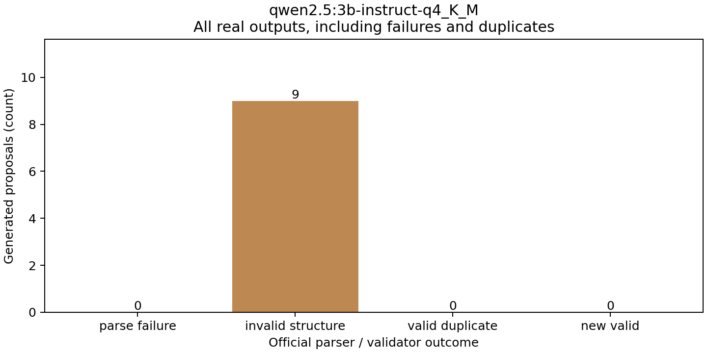

# HypoSpace local Qwen baseline — EEC 4300

**Real smoke test completed; quality gate failed. Formal baseline is NOT complete.**

Model: Qwen2.5-3B-Instruct, Q4_K_M, Ollama 0.40.18, local CPU only, no commercial API or API key. Exact digest and template hash: [model-lock](experiments/model-lock.json).

Nine real calls on three development observations: V=0, U=0.888889, R=0; parse success 9/9, truncations 0; 6,888 input tokens, 903 output tokens, 206.53 seconds of model calls. These are smoke measurements, not estimates or simulated data. They do not establish performance on the formal test set.

Inspection confirms the correct observations were sent. All nine outputs violate the top-view constraint; one also violates support. Several copy the prompt's four-corner example. Example imitation is a plausible cause, not a proven causal finding. No model was substituted and no evaluator was relaxed. Per the owner's requirement to report poor 3B performance first, the 585-call formal run has not started. Proposed formal settings remain provisional until this gate is resolved; a controlled dev-only prompt ablation is the next experiment.

- [Local SSD setup and commands](docs/local-setup.md)
- [Protocol, interfaces and equal-budget rules](docs/baseline-protocol.md)
- [Exact configuration](experiments/protocol.json) / [data split](experiments/manifest.json)
- [Real smoke metrics](docs/figures/smoke/metrics.json) / [raw output hashes](docs/figures/smoke/raw-manifest.json)
- [Run log and failure analysis](docs/experiment-log.md)
- [Chinese teammate prompt](docs/team-message.txt)

Full real requests/responses remain on the owner's SSD under `HypoSpaceLocal/runs/smoke/raw`; model weights and environments are not in Git. The older docs/figures/offline directory is explicitly a historical non-LLM plumbing test and must not be used as an LLM result.

Core APIs: `src/ollama_client.py` (local inference), `src/experiment_api.py` (data/evaluation), `src/hypospace_runner.py` (recorded experiments), `src/compare_runs.py` (matched-budget comparisons). Six tests pass. Official evaluator pinned to c69e9318577b34b5b896996571aefd4ba6053f58.

Course requirement: a novel ML method improving LLM hypothesis generation, public repository, and 10-minute group video with all four members speaking. The paper already includes complexity-stratified decoding; merely adding that is not a novelty claim.

References: [HypoSpace paper](https://proceedings.mlr.press/v306/chen26bz.html), [official code](https://github.com/CTT-Pavilion/_HypoSpace), [exact model tag](https://ollama.com/library/qwen2.5:3b-instruct-q4_K_M).
