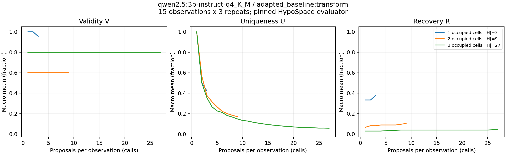

# HypoSpace Qwen 3B Final Project

**正式配对实验已完成。** 同一 Qwen、15 个观测和 3 个种子，Original 与 Adapted 各 585 次。三个队友共同使用冻结的 Adapted。

[分难度成绩、对比图和覆盖曲线](docs/paired-results.md) · [协议核查与复现](docs/baseline-audit.md) · [队友协作说明](docs/team-message.txt)

585/585 real local Qwen calls completed. Model, sampling and data IDs were frozen using development data. A history implementation defect discovered in an aborted partial test run was repaired, rechecked on dev, and the complete 585-call run was restarted. No sampling hyperparameters were tuned on test, but test was not strictly unseen for this repair. Original official prompt remains available without --method. Adapted Baseline uses adapted_baseline:transform; teammate methods start from this same prompt.

Macro V=0.785185, U=0.216461, R=0.174486.
Calls=585; input tokens=178307; output tokens=28776; summed inference wall time=3275.129 seconds; truncated outputs=0. Cost=0 commercial API fees.

Full aggregate/sample SD, per-stratum results, task records and curves: figures/baseline/metrics.json. Raw output checksums: figures/baseline/raw-manifest.json. Full prompts, model responses and timings remain on SSD at HypoSpaceLocal/runs/adapted-formal-v4/raw. No outputs were replaced by simulated answers. Figures show all official scoring outcomes, including invalid and duplicate outputs.

Reproduce: python src/hypospace_runner.py --method adapted_baseline:transform --out <SSD>/runs/adapted-formal-v4
Export: python experiments/finalize_baseline.py (owner's default local path; otherwise use export_run.py and plot_results.py directly).

The adapted prompt improves task readability but is not a claimed novel algorithm. Small dev/test samples and prompt-based generation limit generalization. Development Original Baseline metrics and formal Adapted metrics use different observation/budget settings and must not be interpreted as a controlled test-set improvement estimate. The matched dev comparisons are in dev-study.json.

[Local setup](docs/local-setup.md) · [Protocol](docs/baseline-protocol.md) · [Development diagnosis](docs/dev-analysis.md) · [Team handoff](docs/team-message.txt)
