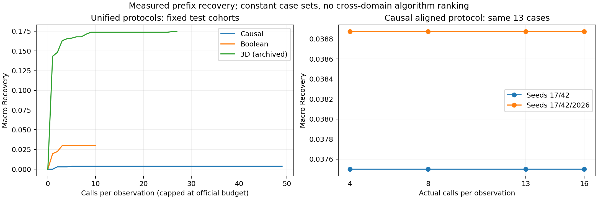
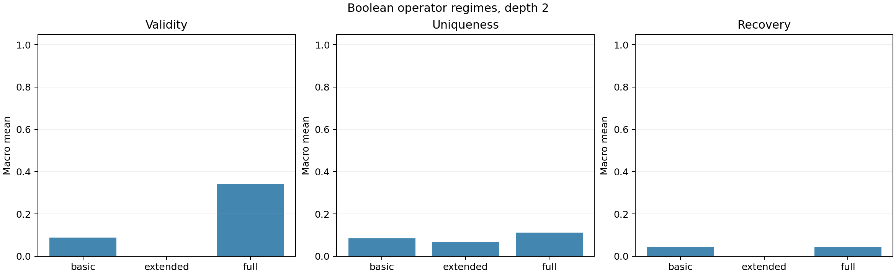
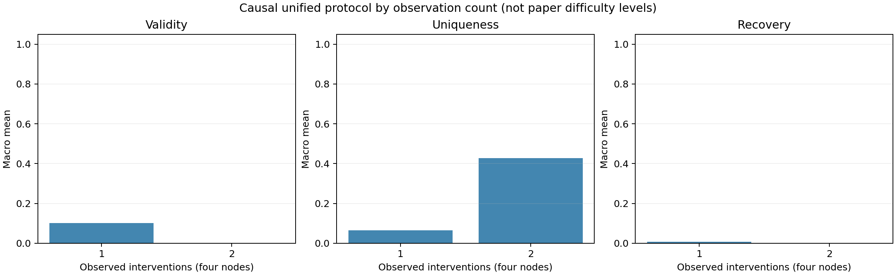
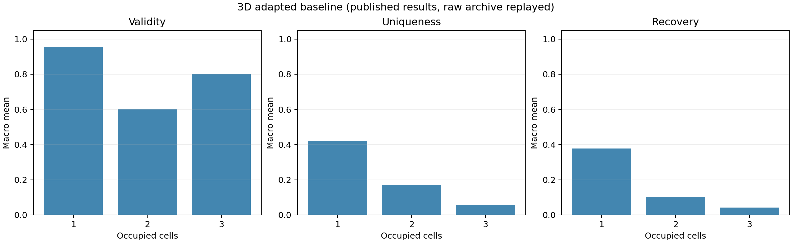
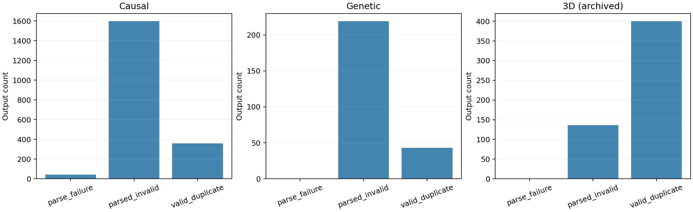
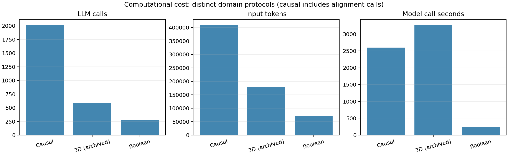

## Baseline Results Across Three Domains

| Domain | Model | Validity | Uniqueness | Recovery | LLM Calls |
| --- | --- | ---: | ---: | ---: | ---: |
| Causal Graph Inference | Qwen2.5-3B | 5.05% | 24.66% | 0.37% | 654 |
| 3D Voxel Reconstruction | Qwen2.5-3B | 78.52% | 21.65% | 17.45% | 585 |
| Boolean Genetic Interaction | Qwen2.5-3B | 14.35% | 8.76% | 2.98% | 270 |

These are within-domain diagnostic measurements, not a fair comparison of algorithm performance across domains. The unified baseline uses the frozen 3D sampling parameters, task-adapted prompts and official scoring. New runs use seeds 17/42/2026 and one call per compatible hypothesis on their frozen test subsets. The causal study uses four nodes and at most four edges; Boolean studies basic/extended/full operators at depth two. The 3D figures are preserved from the archived report; its published 585-call compressed raw archive has been independently replayed on this machine (see historical-3d-replay.json).

The causal alignment protocol reuses a single batch on LWT's 13 final test cases at budgets 4/8/13/16. Total new causal calls including alignment are 2019. Macro means weight instances equally; micro pooling and across-seed sample standard deviations are reported separately. Different official budgets and solution-space sizes make cross-domain Recovery incomparable as an algorithm ranking.

See [shared reproduction commands](../../methods/szh-baseline-common/README.md), and task-specific tracked reports and raw SHA256 manifests.

## Measured resources

| Domain | Calls | Input tokens | Output tokens | Model seconds | Commercial cost |
| --- | ---: | ---: | ---: | ---: | ---: |
| causal | 2019 | 410117 | 26903 | 2600.86 | $0 |
| genetic | 270 | 71469 | 2218 | 240.78 | $0 |

## Causal aligned baseline prefixes

| Seeds | Budget | Validity | Uniqueness | Recovery |
| --- | ---: | ---: | ---: | ---: |
| 17,42 | 4 | 25.00% | 44.23% | 3.75% |
| 17,42 | 8 | 26.44% | 24.04% | 3.75% |
| 17,42 | 13 | 26.92% | 15.68% | 3.75% |
| 17,42 | 16 | 26.92% | 12.74% | 3.75% |
| 17,42,2026 | 4 | 25.64% | 46.15% | 3.89% |
| 17,42,2026 | 8 | 27.24% | 25.32% | 3.89% |
| 17,42,2026 | 13 | 27.81% | 16.17% | 3.89% |
| 17,42,2026 | 16 | 27.88% | 13.14% | 3.89% |

LWT source reports final R@4=36.34%, R@8=47.34%, R@16=56.66% for seeds 17/42, and R@13=53.43% for three seeds. These are teammate-reported values, not independently replayed measurements here (Historical Replay Not Verified). Its 256-token GPU configuration differs from the 512-token CPU baseline. Raw teammate data are required before claiming a fully audited fair comparison.

## Failure accounting

| Domain | Invalid | Parsing failures | Valid duplicates |
| --- | ---: | ---: | ---: |
| causal | 1639 | 42 | 359 |
| genetic | 219 | 0 | 43 |

Per-call scores, per-instance/seed/level metrics, prefix curves, micro rates and seed standard deviations are in each task reports/test.json. New raw records remain in ignored runs/all-domains/. Replay checks every reconstructed request, response manifest, prefix score and summary.

## Same-case, same-call-budget comparison with the reported LWT final method

| Test cases | Seeds | Calls per case | Adapted baseline R | LWT final R (reported) |
| --- | --- | ---: | ---: | ---: |
| Same 13 cases | 17, 42 | 4 | 3.75% | 36.34% |
| Same 13 cases | 17, 42 | 8 | 3.75% | 47.34% |
| Same 13 cases | 17, 42, 2026 | 13 | 3.89% | 53.43% |
| Same 13 cases | 17, 42 | 16 | 3.75% | 56.66% |

LWT figures are quoted from [its final formal report](https://github.com/szh1212/hypospace-final-project/blob/47c9500c22e4c35a931a76544677fb31baef74a3/docs/experiment-results.md). Historical Replay Not Verified. This table aligns task, case identities, call budgets and the listed seeds. It does not claim identical decoding: LWT used 256 output tokens and GPU execution, while the adapted baseline preserves 512 output tokens and CPU execution from the frozen 3D configuration. No paired confidence intervals or independently verified LWT prefix scores are claimed.

## Development overhead

Two smoke passes used 60 additional calls, reported separately from formal budgets. See development-study.json for exact per-pass token and time accounting; development-raw.jsonl.gz preserves those requests. The only prompt revision was Boolean input formatting and allowed-operator descriptions, performed before formal freeze.

## Seed uncertainty and pooled metrics

Sample standard deviations below are calculated from the three seed-level macro means (ddof=1), not from all instance-seed cells. Micro rates pool numerators and denominators while keeping each seed as a separate trial.

| Domain | V mean +/- seed std | U mean +/- seed std | R mean +/- seed std | Micro V | Micro U | Micro R |
| --- | ---: | ---: | ---: | ---: | ---: | ---: |
| Causal | 5.05% +/- 4.22% | 24.66% +/- 1.09% | 0.37% +/- 0.17% | 10.09% | 9.02% | 0.61% |
| 3D | 78.52% +/- 1.28% | 21.65% +/- 1.64% | 17.45% +/- 0.38% | 76.58% | 11.11% | 8.21% |
| Boolean | 14.35% +/- 5.21% | 8.76% +/- 1.12% | 2.98% +/- 1.28% | 18.89% | 9.26% | 2.96% |

## Failure interpretation and implementation limits

Across all causal calls (including the alignment cohort), 1,597 parsed graphs failed the observed intervention constraints, 42 were rejected by the parser, and 359 valid outputs repeated prior valid structures. There were only 21 new valid structures across independent instance-seed cells. Uniqueness includes distinct parsed graphs that fail observations, so high U does not imply useful valid diversity.

Boolean calls produced 135 parsed expressions outside the official space and 84 expressions that failed observations. Of the 51 valid outputs, 43 were duplicates. The official generator/validator also has a reference inconsistency: 1/34 extended and 31/65 full reference formula representatives are rejected by its `_in_space` validator. Primary scores retain the official implementation and denominators. This does not prove every alternate representation of those keys is unattainable, and it limits interpretation of coverage. Details are in [the audit](audit.md) and [reference checks](official-space-check.json).

The new runner uses Python 3.11.7; the published 3D run used Python 3.12.4. Model, digest, Ollama version and all locked sampling parameters match. Timing is summed measured model-request time; environments and task budgets differ, so cost charts are descriptive rather than normalized hardware comparisons. See runtime.json.

## English figures

The left panel keeps every unified test instance in the mean and caps each prefix at its official per-instance budget. Completed smaller-budget cases retain their final measured recovery. The right panel uses the same 13 causal cases at actual budgets 4/8/13/16. The supplementary budget-curves figure averages only cases with an available prefix and therefore changes its cohort with k.

Both PNG and vector PDF files are provided. New raw request/response archives and SHA256 manifests are tracked in each task's reports/ directory; original uncompressed records remain in ignored runs/all-domains/.
