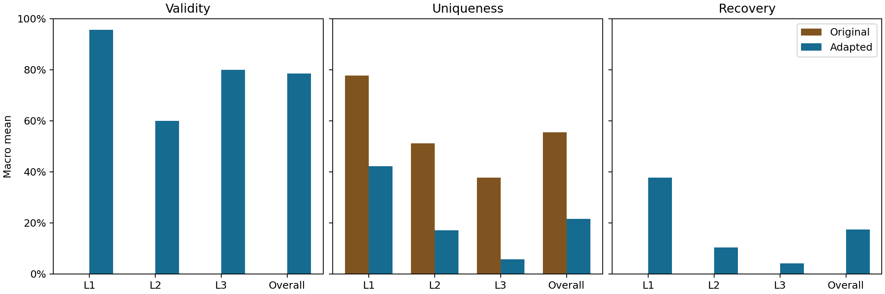
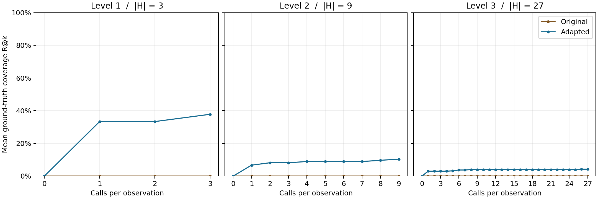

# Original and Adapted on the frozen test split

|Level|Calls per method|Original V|Original U|Original R|Adapted V|Adapted U|Adapted R|
|---|---:|---:|---:|---:|---:|---:|---:|
|1|45|0.00%|77.78%|0.00%|95.56%|42.22%|37.78%|
|2|135|0.00%|51.11%|0.00%|60.00%|17.04%|10.37%|
|3|405|0.00%|37.78%|0.00%|80.00%|5.68%|4.20%|
|Overall|585|0.00%|55.56%|0.00%|78.52%|21.65%|17.45%|

Each difficulty averages five observations and three seeds. Overall gives equal weight to the 45 observation–seed pairs. Each prefix uses the original proposal order.

- Original: 585 calls, 561,221 input and 64,641 output tokens, 11028.3 summed request seconds, 8 length-limited responses. Outcomes: {'parse failure': 0, 'invalid structure': 585, 'valid duplicate': 0, 'new valid': 0}.
- Adapted: 585 calls, 178,307 input and 28,776 output tokens, 3275.1 summed request seconds, 0 length-limited responses. Outcomes: {'parse failure': 1, 'invalid structure': 136, 'valid duplicate': 400, 'new valid': 48}.

[Protocol audit and reproduction](baseline-audit.md) · [Team instructions](team-message.txt)
